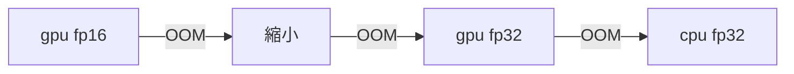

# GPU優先推論（device=auto）設計

- 目的: 推論（stems・lyrics・alignment）をGPU（cuda）で最大限動かし、使えない環境だけCPUへ落とす。
- 状態: 実装済み（torchモックの単体テストのみ。実機GPU・実モデルは未確認）
- 最終確認日: 2026-11-28
- 関連: [Stem](../stem_separation.md)、[歌詞認識](../lyric_transcription.md)、[Alignment](../lyric_alignment.md)、[#43推論分離](issue-43-inference-isolation.md)

## 範囲

対象は `python/src/open_karaoke_analysis/` の `device.py`（新設）、`stems.py`・`lyrics.py`・`alignment.py`（Options）、`stem_backend.py`（OpenUnmix）、`whisper_backend.py`、`alignment_backend.py`（Wav2Vec2）です。F0・MIDI等のCPU処理は対象外です。

## 仕様

| 項目 | 内容 |
|---|---|
| `device` の値 | `auto`（既定）・`cpu`・`cuda`。`auto` はOptions検証時に `cuda` 利用可なら `cuda`、不可・torch未導入なら `cpu` へ解決する。 |
| 明示指定 | `cpu`/`cuda` はそのまま尊重する。`cuda` 明示でGPUが無い場合は従来どおり `device_unavailable`（503）。 |
| 解決の位置 | Options検証（`validate_options`）。解決後の値がcache identityと完了artifactの `device` に入るため、記録は実際の値になる。 |
| 精度 | cudaではfp16。Whisperは重みを `half()`、OpenUnmixとWav2Vec2は `torch.autocast(cuda, float16)`（重みはfp32のまま）。GTX1080はbf16不可のためfp16固定。 |
| 推論モード | 全backendで `torch.inference_mode`。 |
| 転送 | モデルはCPUで検証済み重みを組み立て後、対象デバイスへ1回だけ転送する。入力はチャンクごとに1回転送し、出力のみCPUへ戻す。 |

## OOMフォールバック

`device.run_with_oom_fallback` が、OOM（`OutOfMemoryError` または文言 `out of memory` のRuntimeError）のときだけ次の段階へ進めます。OOM以外の例外は即再送出し、全段階OOMなら最後の例外を返します。段階が進むたびにCUDAキャッシュを解放します。

| backend | 縮小の内容 |
|---|---|
| OpenUnmix | チャンクを前後1秒の文脈つきで二分割し、文脈分を捨てて連結（約2秒以上の半分が残るときだけ）。 |
| Whisper | `beam_size` を1へ。 |
| Wav2Vec2 | なし（CTC整列は全体文脈に依存し、分割で結果が変わるため）。fp16→fp32→CPUのみ。 |

一度落ちた段階は同一backendインスタンスで維持します（次のチャンクで再度OOMを繰り返さない）。`cpu` 指定・解決時は段階が1つだけで挙動は従来と同じです。

## テスト

`python/tests/test_device_fallback.py`（torchモック）で、auto解決、明示指定の尊重、OOM判定、各backendの段階遷移、二分割結果が一括推論と一致すること、CPUでは段階が1つであることを確認します。**実機GPU・実モデルの推論は未確認**です（重い推論は共通キュー `gpu-training` 経由で別途実施する）。fp16と二分割で出力が実モデルでどの程度変わるかは未測定です。

## 未決事項

- 実機（GTX1080）でのfp16精度差・VRAM使用量・速度の測定。
- 解決後の `device` がOOMでCPUへ落ちた場合に、完了artifactへ「実際に使ったデバイス」を再記録するか（現状はOptions解決時の値）。
